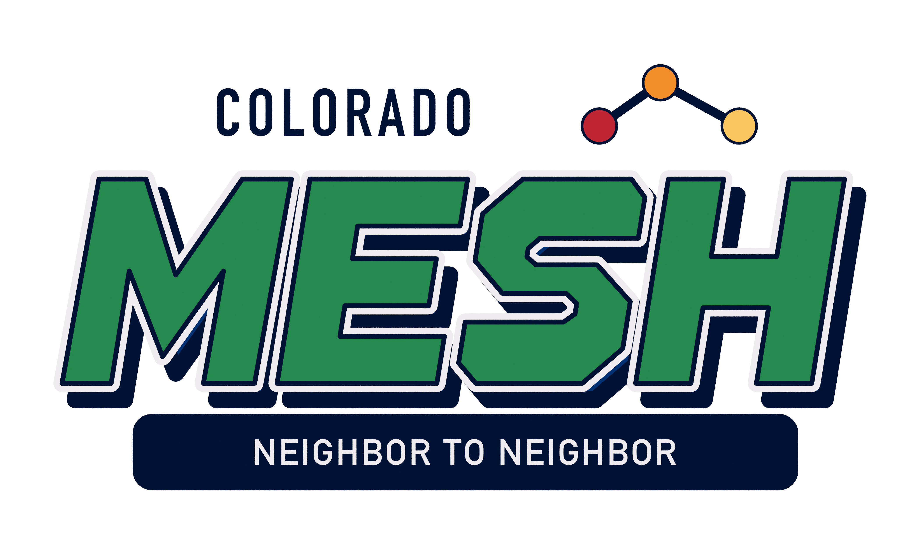
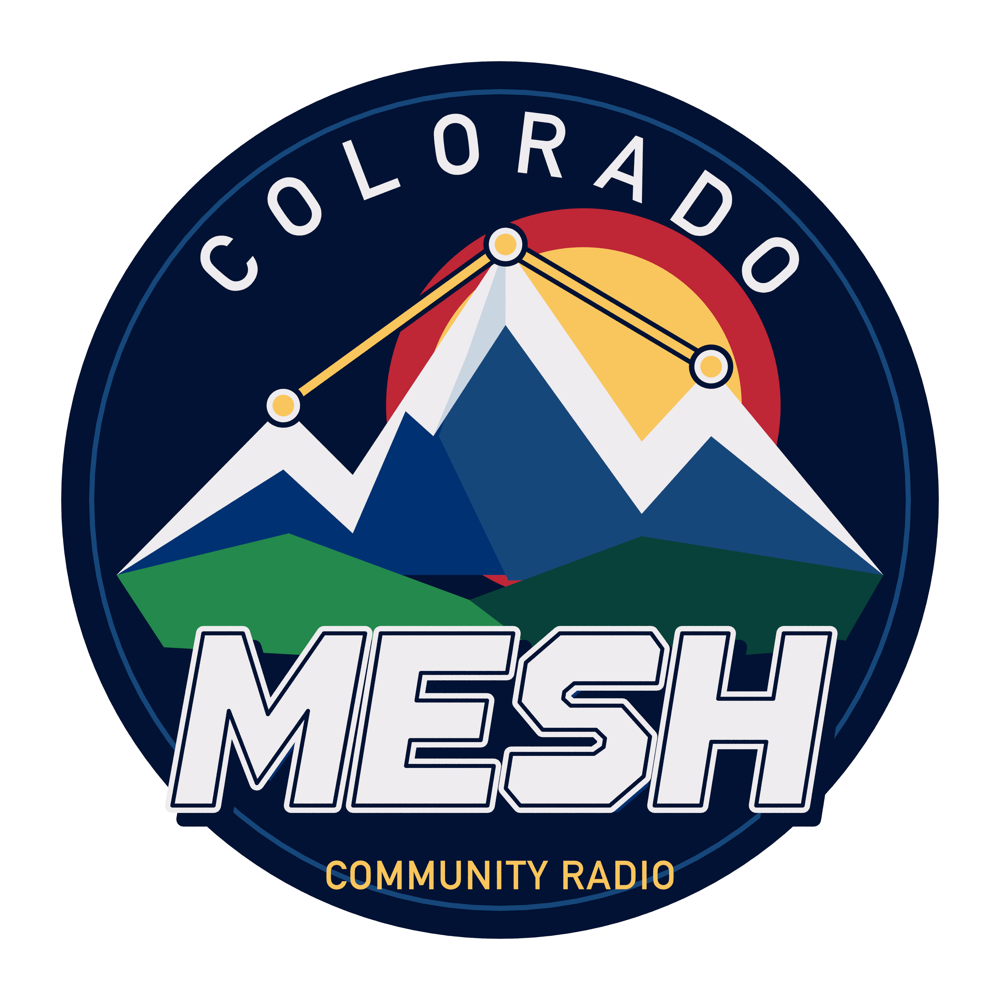
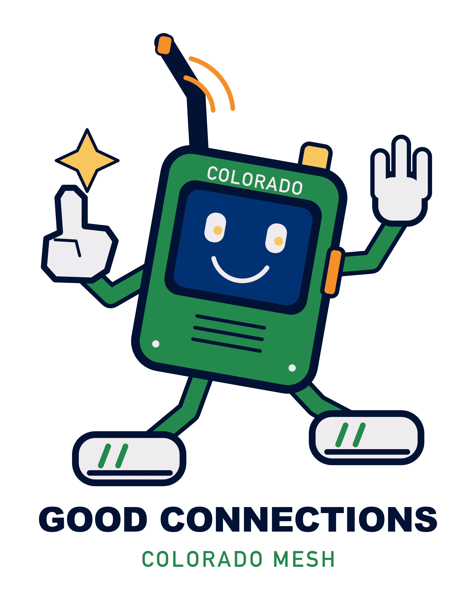

# Colorado Mesh / Signal Club sticker artwork

Three high-resolution PNGs for sticker production. Download the original PNG files using the links below.

| Artwork | Resolution | Sticker size at 900 ppi |
| --- | --- | --- |
| [MESH Supply](01-mesh-supply.png) | 4,140 × 2,520 px | 4.29 × 2.35 in |
| [Alpine Frequency](02-alpine-frequency.png) | 3,240 × 3,240 px | 3.34 × 3.34 in |
| [Good Connections](03-good-connections.png) | 3,465 × 4,365 px | 3.40 × 4.50 in |

All three files are **transparent RGBA PNGs at 900 ppi**, with the white sticker border included. Transparency is outside the sticker silhouette. The PNG canvases include a small transparent margin; the sizes above describe the sticker silhouette. Scale uniformly if choosing a different finished size.

Original artwork built in Blender using [Colorado Mesh logo v2's color family](https://github.com/Colorado-Mesh/branding/tree/main/logos/logo-v2). Logo reference credits: megabear — KD5IHC (original green/blue icons) and Johnny — W5KV (color icon).
